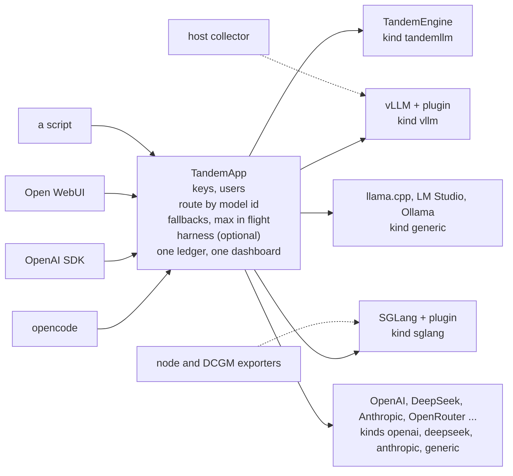

# Backends: other engines and cloud APIs behind TandemApp

TandemApp puts any number of engines and cloud APIs behind one address, from vLLM and SGLang to OpenAI, Anthropic, DeepSeek, OpenRouter and another TandemEngine. Clients send every request to TandemApp, which routes it by the model id and copies the answer back. This page covers the flags each engine needs, how a request finds its backend, and how keys and costs are kept. The figures TandemApp reads from each engine and machine are on [monitoring.md](monitoring.md).



TandemApp reads each engine's `/metrics` every 15 s, and the plugins' posts.

## Backend kinds

Every backend has a kind. The kind decides the default URL, the routes that are relayed, how the proxy reads cached and reasoning tokens, and what the conductor can do there.

| kind | for | routes relayed | the engine's own figures |
|-|-|-|-|
| `vllm` | a vLLM server | chat, completions, embeddings, Responses | `/metrics` every 15 s, and the plugin |
| `sglang` | an SGLang server | the same | `/metrics` every 15 s, and the plugin |
| `generic` | llama.cpp, LM Studio, Ollama, any OpenAI-compatible server | the same | none |
| `tandemllm` | another TandemLLM engine | the same | its live board, read through the relay |
| `openai` | OpenAI's API | the same | none |
| `deepseek` | DeepSeek's API | chat, completions | none |
| `anthropic` | Anthropic's API, or any server that speaks the Messages API | the Messages API; a chat completion is translated to it | none |

*Backend kinds.*

A vLLM or SGLang server also works as `generic`. The `vllm` and `sglang` kinds add the metrics page, the plugin join and the conductor's reasoning close ([proxy.md](proxy.md#the-harness-in-front-of-a-backend)). A backend speaks one of two protocols: `openai` (chat completions, completions, embeddings, the Responses API where the server has it) or `anthropic` (the Messages API). Clients can use either protocol against any backend; [proxy.md](proxy.md#the-messages-api) says what a translation between them keeps and loses.

## Adding a backend

In the GUI, open `/dashboard/#/backends` and choose Add backend. One form does it:

1. **Provider.** A list in three groups: cloud APIs that need only a key (OpenAI, Anthropic, OpenRouter, DeepSeek, Z.ai, Moonshot, MiniMax, Nous Research, Google Gemini, xAI, Mistral, Groq, Together AI, Fireworks AI, Cerebras, Qwen, Hugging Face), servers you run (TandemEngine, vLLM, SGLang, Ollama, LM Studio, llama.cpp) and two custom entries, *Custom (OpenAI-compatible)* and *Custom (Anthropic-compatible)*, for any other server by its URL.
2. **Protocol.** For a provider that serves both, OpenAI-compatible or Anthropic-compatible.
3. **Base URL.** Filled in from the provider; a custom entry needs one.
4. **Key.** With a link to the provider's key page; optional or absent for most servers you run.
5. **Connect.** TandemApp tests the backend first (the latency and the models found) and saves it only when the test passes. A refused test offers *Save anyway*; *More settings* opens the full form.

The providers are in `proxy/presets.py` and on `GET /v1/config/presets`. A preset only fills the form: the backend stores its kind, URL, key, whether it is a paid cloud API (the longer cloud timeouts; the harness stays off for its paid models) and the preset's id, which names it on its card. A provider that moves its URL breaks nothing already saved. Adding a provider is one entry in `proxy/presets.py`.

The full form holds the backend's label, its models (discovered from `GET /models` or a fixed list), fallbacks, the most requests it takes at once, timeouts, where its machine is read, and the conductor's switches. Every change is a row in the audit table with who and when, never a key's value.

In an env file, the same fields are `TANDEM_*` variables:

```sh
TANDEM_BACKENDS=vllm1,deepseek
TANDEM_BACKEND_VLLM1_KIND=vllm
TANDEM_BACKEND_VLLM1_URL=http://gpu-host:8100/v1
TANDEM_BACKEND_DEEPSEEK_KIND=deepseek          # a cloud kind fills its URL in
TANDEM_BACKEND_DEEPSEEK_KEY=<your DeepSeek key>
TANDEM_ROUTE_1="deepseek-*=deepseek"
TANDEM_PRICE_1="deepseek/deepseek-flash=0.30,0.006,1.2"
```

`<ID>` in a variable name is the backend id in capitals, with `-` written as `_`. The environment wins field by field: at every start the variables are written over the database's rows, and a backend is created when it is missing. The GUI shows each field a variable sets as locked, with the variable's name on it; a save that changes such a field answers 422 and names the variable. When the variable goes away, the field can be edited again and keeps its last value. An unknown variable, an unknown backend or a value the schema refuses stops the start with a message that names the variable. One schema, `proxy/config.schema.json`, checks both ways in. [reference/variables.md](reference/variables.md) lists every variable.

## vLLM

Start vLLM with a tool-call parser and the flags the dashboard reads. For a Qwen3.5 or Qwen3.8 model:

```sh
vllm serve Qwen/Qwen3.5-4B --port 8100 \
    --enable-auto-tool-choice --tool-call-parser qwen3_coder \
    --reasoning-parser qwen3 \
    --enable-prompt-tokens-details
```

| flag | why |
|-|-|
| `--enable-auto-tool-choice --tool-call-parser <p>` | without a tool parser vLLM answers 400 to any request that carries `tools`. Coding agents send tools on every turn, and so does the conductor's memory writer (with `tool_choice: "none"`) |
| `--enable-prompt-tokens-details` | the cached prompt tokens in each answer's `usage`; without it the ledger has no per-request cache figure |
| `--reasoning-parser <p>` | the reasoning arrives as `delta.reasoning` and counts as reasoning tokens; without it the reasoning is part of the content |

*The vLLM flags the proxy needs, and why.*

vLLM's `/metrics` page is always on. Then add the backend with kind `vllm` and the URL `http://engine-host:8100/v1`. Two facts from vLLM v0.30.0's source matter here: vLLM removed the `guided_choice` family of fields and still answers 200 without the constraint, so a constrained question must use `structured_outputs.choice`; and vLLM takes a client's `X-Request-Id` as the request id, which the plugin join uses.

## SGLang

```sh
python -m sglang.launch_server --model-path Qwen/Qwen3.5-4B --port 30000 \
    --enable-metrics --enable-cache-report \
    --tool-call-parser qwen3_coder --reasoning-parser qwen3
```

`--enable-metrics` turns on the `/metrics` page; without it the page answers 404, the backend's card says how to turn it on, and the plugin's hooks do not run. `--enable-cache-report` puts the cached prompt tokens into each answer's `usage`. `--tool-call-parser` returns tool calls as OpenAI `tool_calls`; without it SGLang returns the model's raw call text, and it does not hold the model to `tool_choice: "none"`. `--reasoning-parser` returns the reasoning as `reasoning_content`; without it SGLang still sends `reasoning_tokens: 0`, which the proxy reads as null when the stream carried reasoning.

Add the backend with kind `sglang`. The proxy never calls SGLang's `/health`: on an idle server that route runs a one-token generation. The health poll reads `GET /v1/models` instead.

## One command: tandem-app launch

On the engine's machine, `tandem-app launch` does the steps above at once. It registers the backend in the config database (kind, `http://127.0.0.1:<port>/v1`, host `same`), hands the engine the proxy's collect URL and token, adds the flags the dashboard reads (`--enable-prompt-tokens-details` on vLLM; `--enable-metrics` and `--enable-cache-report` on SGLang), checks that the plugin is installed in the engine's Python, and then replaces itself with the engine, so the process id it records is the engine's.

```sh
tandem-app launch vllm --model Qwen/Qwen3.5-4B --port 8100 -- \
    --enable-auto-tool-choice --tool-call-parser qwen3_coder --reasoning-parser qwen3
tandem-app launch sglang --model Qwen/Qwen3.5-4B --port 30000 -- \
    --tool-call-parser qwen3_coder --reasoning-parser qwen3
```

Everything after `--` goes to the engine unchanged. Without the plugin installed, `launch` says how to install it and starts the engine without it (layer L1 only). `--dry-run` prints the command and starts nothing. [reference/commands.md](reference/commands.md) lists the options; [monitoring.md](monitoring.md#inside-vllm-and-sglang-the-plugins-l2) explains the plugins.

## Any OpenAI-compatible server

llama.cpp's `llama-server`, LM Studio, Ollama's `/v1` API and other servers are kind `generic`. Give the base URL including `/v1`: `http://127.0.0.1:1234/v1` for LM Studio, `http://127.0.0.1:11434/v1` for Ollama. What the proxy can measure depends on what the server sends. Tokens come from the answer's `usage`; the proxy asks a stream for its usage frame when the client did not and drops that frame before the client sees it. A server that never sends `usage` gets null token counts, never estimates. Thinking on or off goes through `chat_template_kwargs.enable_thinking`, which Qwen-family templates read and others ignore. `llama-server` needs `--jinja` for tools.

## OpenAI and the Responses API

Kind `openai`, with the key in the key field or `TANDEM_BACKEND_<ID>_KEY`; the URL is filled in. Chat completions, completions, embeddings and the Responses API (`POST /v1/responses`) are relayed. A Responses request goes to the backend as the client sent it, apart from the model id, and the conductor does not act on it. Cached tokens come from `prompt_tokens_details.cached_tokens` (chat) and `input_tokens_details.cached_tokens` (Responses); reasoning tokens from `completion_tokens_details.reasoning_tokens`. The conductor sends `reasoning_effort` only to model ids that start with `o1`, `o3`, `o4` or `gpt-5`. The adapter is tested on frames written from OpenAI's documented shapes, not on a paid call.

## DeepSeek

Kind `deepseek`, or the DeepSeek provider with the Anthropic-compatible protocol (kind `anthropic`). Chat completions and completions are relayed; DeepSeek has no embeddings or Responses API. Cached tokens come from `prompt_cache_hit_tokens`, and the reasoning arrives as `reasoning_content`. Thinking goes on and off through `thinking.type`; DeepSeek has no budget, so an effort level is on or off and never a cap. DeepSeek charges half outside its peak hours (01:00 to 04:00 and 06:00 to 10:00 UTC on weekdays); a price row can carry an `offpeak` block, and the adapter picks it by the request's UTC hour. Chinese public holidays count as peak here, so their cost reads high.

## Anthropic and other Messages API servers

Kind `anthropic`, with the key; the Anthropic provider fills in `https://api.anthropic.com`, and DeepSeek, Z.ai, Moonshot and MiniMax offer an Anthropic-compatible URL too. TandemApp sends the key as `x-api-key` (or `Authorization: Bearer` with the backend's `anthropic.auth: bearer`) and `anthropic-version` (`2023-06-01` by default); none of the client's headers go on. A Messages API client's request passes through untranslated when every backend of its route is of kind `anthropic`; an OpenAI client's chat completion is translated to a Messages request and back. Models come from `GET <base>/v1/models`, page by page. The usage arrives in every answer: the prompt is input plus cache read plus cache write, the cached tokens are the cache read, and 1-hour cache writes are priced at `cache_write_1h`. The harness does not run on this kind. [proxy.md](proxy.md#the-messages-api) has every rule of the translation, the pass-through and the thinking stash; the backend's settings (`auth`, `api_version`, `sampling`, `default_max_tokens`, `auto_cache`, `thinking_display`, `thinking_shape`) are its `anthropic` object, or `TANDEM_BACKEND_<ID>_ANTHROPIC_<FIELD>`.

## Another TandemEngine

Kind `tandemllm`, with the engine's URL. The proxy lists the engine's `TandemLLM` model and relays to it. The relay sends `X-Tandem-Relay-Id`; the engine files the request under it, and the Parallel view reads the engine's own live counts while requests run there. That read follows the engine's dashboard rule: with the engine's login off it answers anyone who reaches the port, and with the login on only a caller on the engine's own machine.

## Routing by model id

`GET /v1/models` lists every backend's real model ids, with `owned_by` set to the backend's id and a `tandem` block (backend, kind, label, upstream id, context length, switches). A request goes to the first of these that applies:

1. an explicit `<backend>/<model>` prefix, such as `vllm1/Qwen/Qwen3.5-4B`;
2. the first enabled routing rule whose glob matches the id (Backends, Routing, or `TANDEM_ROUTE_<n>`, ordered by `n`);
3. the one backend that serves the id;
4. else OpenAI's 404 `model_not_found`, which names the prefixed forms when two backends serve the id.

When two backends serve one id, both are listed as `<backend>/<model>` and the bare id is not. A model can get a public id of its own in the GUI. In the engine's own server, `TandemLLM` stays the engine's.

A backend or a single model may name fallbacks. On a connect error, a 429, a 502 or a 503 before any byte reached the client, the proxy tries the next backend at once, or the same one again after 1 s, then 2 s (or its `Retry-After`, up to 30 s), at most 2 more tries in all. After the first byte, a failure is an `error` frame and `[DONE]`. The proxy adds no limit of its own to how many requests a backend takes at once: a cloud API, vLLM or SGLang gets as many as clients send and answers its own 429 or 503 when it is full. A backend's `max_inflight` (1 to 4,096; 64 when it is not set, `none` is no limit) is a cap you set: past it a request goes to a fallback with room, else it gets a 503 with `Retry-After: 1`. How many requests TandemLLM's own engine decodes at once is the engine's setting (`QSE_PARALLEL`, [TandemEngine's parallel requests](https://github.com/TandemLLM/TandemEngine/blob/main/docs/parallel-requests.md)), shown on the Backends screen under its name. Timeouts are per backend: a local engine gets 5 s to connect, 600 s to the first byte and 120 s between frames; a cloud API 10, 120 and 60 s. A client that leaves closes the upstream connection within a quarter second, so the backend stops generating.

## Keys at rest

A backend's key is stored as AES-256-GCM ciphertext in the config database. The master key comes from the first of these sources that answers:

1. `TANDEM_SECRETS_KEY`, base64 of 32 bytes (`openssl rand -base64 32`);
2. the OS keychain (`security` on macOS, `secret-tool` on Linux), read only; `--no-keychain` skips it;
3. `secrets.key` beside the config database, made once at mode 0600.

`tandem-app secrets status` says which one answers. No API answer, log line, ledger row or audit row holds a key: the GUI gets whether a key is set, its last 4 characters and 6 hex digits of its sha256, and the key field is write-only.

This protects a copied or backed-up database. It does not protect against a process that runs as the same user, which can read the key file as easily as the proxy can, and a backup of the whole directory carries the key file too. Keep the master key in the environment or the keychain when backups leave the machine. A lost master key means typing the backends' keys in again, nothing else. To move the key file into the macOS keychain:

```sh
security add-generic-password -s tandemllm -a secrets-key -w "$(cat ~/.tandemllm/secrets.key)"
rm ~/.tandemllm/secrets.key
```

## Accounts and API tokens

People sign in with an account (viewer, operator, admin or owner). Programs use an API token, made on the Access page or with `tandem-app tokens create`: `tdm-` and random characters, shown once and stored as its sha256, with scopes (`inference:openai`, `inference:anthropic`, `settings:read` and others), model globs, an expiry and limits. Another device needs a token and the protocol's exposure switch on network (Settings, API). The token's owner goes into the ledger's `user` column, and the Usage view filters by it. [auth.md](auth.md) has the details.

The configuration routes (`/v1/config`) need an operator's session, or a token with `settings:write`, to change anything. Being on the same machine opens nothing outside local mode. The default bind is `127.0.0.1`; keep the port on a trusted network.

Putting one cloud key in front of several people makes you the provider toward them. The provider's terms hold the key holder responsible for what those people send, and most forbid reselling access without an agreement. Per-user keys keep each person's usage visible in the ledger. This is not legal advice.

## Prices and cost

A price row per model holds USD per million tokens for input, cached input, cache write and output. The cost of a request is

```
(prompt - cached) · p_in + cached · p_cached + cache_write · p_write + completion · p_out
```


written into the ledger row when the request ends, at the price of that moment, so a later price change never rewrites history. A model without a price has a null cost. The proxy never fetches a price list: `proxy/prices.seed.json` holds OpenAI's and DeepSeek's list prices as read on 2026-10-04, which the model rows offer and apply only on a click. Check the providers' pages before you bill anyone from these numbers.

## What the proxy measures

The proxy records what a client could measure, and every figure is measured or null.

| figure | source |
|-|-|
| prompt, completion tokens | the backend's `usage`; null when it sends none |
| cached prompt tokens | `prompt_tokens_details.cached_tokens` (OpenAI; vLLM and SGLang with their flags), `prompt_cache_hit_tokens` (DeepSeek), `input_tokens_details.cached_tokens` (Responses) |
| reasoning tokens | `completion_tokens_details.reasoning_tokens`, SGLang's `reasoning_tokens`; a reported 0 beside streamed reasoning is null |
| TTFT | arrival at the proxy to the first frame with a token; the network and the backend's queue are inside it |
| decode tok/s | (completion tokens - 1) / (last token frame - first token frame); null without `usage`, because a frame is not a token |
| cost | the model's price when the row is written |
| proxy overhead | arrival to the upstream send, plus the first frame's delay through the proxy |

*Where each figure of a relayed request comes from.*

What the proxy adds is small (measured, the 0.4.0 series). Against a fake backend on one machine it added 0.33 ms to the client's time to first token at the median, its own time was 0.17 ms at p50 and 0.22 ms at p90, and 64 streams at once ended in 5.18 s against 5.22 s for one alone. Against the live engine over the local network, 20 greedy requests gave equal token counts and a decode rate within 0.8 % of the engine's own.

